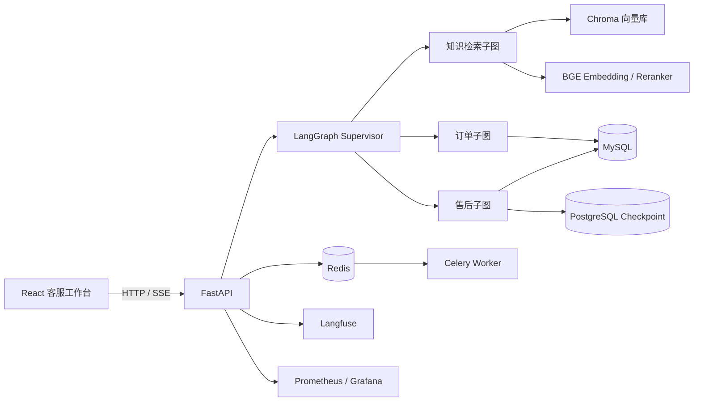

# Smart CS Agent

> 一个可本地运行的电商售后客服 Agent 示例，用于演示知识检索、订单查询、人工审批、流式对话和审计闭环。

[](https://github.com/jianchuang476-netizen/smart-cs-agent/actions/workflows/ci.yml)


Smart CS Agent 是一个面向电商售后场景的全栈示例项目。用户可以在 React 客服工作台提问，系统会自动判断问题类型，并在必要时调用知识库、查询订单或发起人工审批。

项目适合用来学习和二次开发以下能力：

- 使用 LangGraph 编排多节点 Agent 流程
- 构建带引用来源的混合 RAG 检索链路
- 为退款、补偿等高风险操作增加 Human-in-the-loop 审批
- 使用 SSE 实现大模型流式输出
- 管理用户权限、审计记录、后台任务和服务可观测性

> 注意：这是一个用于学习和演示的示例项目，不是可直接商用的生产系统。部署到真实环境前，请更换所有开发密钥，并补充 HTTPS、备份、压测和合规配置。

## 项目能做什么

| 能力 | 说明 |
| --- | --- |
| 智能问答 | 根据售后政策回答问题，并返回引用来源 |
| 订单查询 | 查询订单状态、物流信息和基础订单信息 |
| 售后处理 | 支持退款、补偿、取消订单和创建售后工单 |
| 人工审批 | 高风险操作暂停执行，由客服批准或拒绝后继续 |
| 知识库管理 | 文档上传、状态查看、检索测试和删除 |
| 会话管理 | 保存聊天记录，支持按会话查看历史消息 |
| 实时输出 | 通过 SSE 展示模型 token、工具状态、引用和审批事件 |
| 权限与安全 | JWT、RBAC、CSRF、Redis 限流、PII 脱敏和审计日志 |
| 后台任务 | 使用 Celery 异步解析和索引知识文档 |
| 可观测性 | 提供 Prometheus 指标、Grafana 面板和 Langfuse 追踪集成 |

## 架构



### 数据分工

| 服务 | 主要职责 |
| --- | --- |
| MySQL | 用户、订单、会话、审批、退款、通知和审计数据 |
| PostgreSQL | LangGraph checkpoint，用于保存和恢复 Agent 执行状态 |
| Chroma | 售后政策文档的向量索引 |
| Redis | 请求限流、Celery broker 和任务结果存储 |
| Celery | 异步解析、切片和索引知识文档 |
| Prometheus / Grafana | 请求指标采集和可视化 |
| Langfuse | 模型调用、工具调用和 Agent 执行链路追踪 |

## 快速开始

### 环境要求

- Docker Desktop
- Git
- 一个可用的 DeepSeek API Key
- 首次启动建议预留至少 3 GB 磁盘空间，用于下载本地模型

### 1. 获取代码

```bash
git clone https://github.com/jianchuang476-netizen/smart-cs-agent.git
cd smart-cs-agent
```

### 2. 创建环境变量

PowerShell：

```powershell
Copy-Item .env.example .env
```

macOS / Linux：

```bash
cp .env.example .env
```

打开 `.env`，至少修改下面两项：

```dotenv
JWT_SECRET_KEY=replace-with-a-long-random-secret
DEEPSEEK_API_KEY=replace-with-your-new-api-key
```

### 3. 启动核心服务

```bash
docker compose up --build -d
```

首次启动会下载 `BAAI/bge-small-zh-v1.5` 等模型，因此可能需要几分钟。项目默认使用国内镜像地址 `HF_ENDPOINT=https://hf-mirror.com`，如果下载仍然较慢，可以提前准备模型缓存或使用已配置好的镜像源。

### 4. 初始化演示数据

```bash
docker compose --profile tools run --rm bootstrap
```

该命令会创建演示用户、订单、售后政策和知识库索引。

### 5. 打开服务

| 服务 | 地址 |
| --- | --- |
| 客服工作台 | http://localhost:5173 |
| FastAPI 文档 | http://localhost:8002/docs |
| API 服务 | http://localhost:8002 |
| Chroma | http://localhost:8001 |
| Prometheus | http://localhost:9090 |
| Grafana | http://localhost:3000 |
| Langfuse | http://localhost:3001 |

Prometheus、Grafana 和 Langfuse 属于可选观测组件，需要额外启动：

```bash
docker compose --profile observability up -d
```

## 演示账号

所有演示账号的密码均为 `Demo123!`。

| 角色 | 邮箱 | 可以做什么 |
| --- | --- | --- |
| 客户 | customer@example.com | 聊天、查询订单、发起售后 |
| 客服 | agent@example.com | 审批退款和补偿、查看会话 |
| 管理员 | admin@example.com | 客服能力 + 知识库管理 |

## 使用方式

### 咨询售后政策

进入聊天页面，输入：

```text
七天无理由退货多久内可以申请？
```

系统会检索知识库，返回回答和引用来源。

### 查询订单

```text
帮我查询订单 ORD202600001 的物流
```

具体订单号以初始化后的数据为准。

### 发起退款审批

```text
订单 ORD202600001 我要退款 50 元
```

此时系统不会直接退款，而是返回 `approval_required` 事件，并创建一条待审批记录。使用客服或管理员账号进入审批页面，批准后系统会恢复 LangGraph 流程并执行退款。

### 管理知识库

管理员可以在知识库页面：

- 上传 `.pdf`、`.docx`、`.md` 或 `.txt` 文档
- 查看文档状态、版本和切片数量
- 在页面中测试检索结果
- 删除不再需要的文档

## 配置说明

完整配置见 [.env.example](.env.example)。

| 变量 | 用途 | 默认值 |
| --- | --- | --- |
| `DEEPSEEK_API_KEY` | 模型 API Key | 空，必须配置 |
| `LLM_MODEL` | 使用的对话模型 | `deepseek-chat` |
| `LLM_BASE_URL` | OpenAI 兼容接口地址 | `https://api.deepseek.com` |
| `DATABASE_URL` | MySQL 业务数据库连接 | `mysql+asyncmy://...` |
| `CHECKPOINT_BACKEND` | LangGraph checkpoint 类型 | `postgres` |
| `CHECKPOINT_DATABASE_URL` | PostgreSQL checkpoint 连接 | `postgresql://...` |
| `REDIS_URL` | Redis 和 Celery 连接 | `redis://redis:6379/0` |
| `CHROMA_HOST` | Chroma 服务地址 | `chroma` |
| `EMBEDDING_MODEL` | BGE 向量模型 | `/app/data/models/bge-small-zh-v1.5` |
| `RERANKER_ENABLED` | 是否启用 BGE Reranker | `false` |
| `RATE_LIMIT_REQUESTS` | 单个用户限流请求数 | `60` |
| `LANGFUSE_*` | Langfuse 追踪配置 | 可选 |
| `NOTIFICATION_PROVIDER` | 通知适配器 | `mock` |

## API 概览

主要接口都位于 `/api/v1`。

| 方法 | 路径 | 说明 |
| --- | --- | --- |
| `POST` | `/auth/login` | 登录 |
| `POST` | `/auth/refresh` | 刷新 token |
| `POST` | `/auth/logout` | 退出登录 |
| `GET` | `/auth/me` | 获取当前用户 |
| `POST` | `/chat/stream` | SSE 流式聊天 |
| `GET` | `/sessions` | 获取当前用户会话列表 |
| `GET` | `/sessions/{id}/messages` | 获取会话消息 |
| `GET` | `/approvals?status=pending` | 查询待审批记录 |
| `POST` | `/approvals/{id}/decision` | 批准或拒绝审批 |
| `POST` | `/knowledge/documents` | 上传知识文档 |
| `GET` | `/knowledge/documents` | 获取知识文档列表 |
| `DELETE` | `/knowledge/documents/{id}` | 删除知识文档 |
| `POST` | `/knowledge/search-test` | 测试知识检索 |
| `GET` | `/health/live` | 存活检查 |
| `GET` | `/health/ready` | 就绪检查 |
| `GET` | `/metrics` | Prometheus 指标 |

聊天接口会通过 SSE 返回以下事件：

```text
session
token
tool_call
citation
approval_required
done
error
```

## 项目结构

```text
app/
  api/            FastAPI 路由、鉴权和限流
  core/           LangGraph、Agent 状态、安全工具和 SSE
  db/             数据模型、数据库连接和演示数据
  services/       RAG、订单、审批、审计和通知服务
  worker/         Celery 应用和后台任务
frontend/         React + TypeScript 客服工作台
migrations/       数据库迁移
config/           Prometheus 和 Grafana 配置
data/
  docs/           示例售后政策
  eval/           RAG 路由评测集
  uploads/        上传文档目录
tests/            后端单元测试和集成测试
```

## 本地开发

### 后端

如果要在本机运行后端，请先启动它依赖的基础服务：

```bash
docker compose up -d mysql postgres redis chroma
```
项目仓库中可能包含本地虚拟环境目录 `qiye_agent/`。如果你的环境已经创建了虚拟环境，可以直接使用：

```powershell
.\qiye_agent\Scripts\python.exe -m pip install -r requirements-dev.txt
.\qiye_agent\Scripts\python.exe -m scripts.bootstrap
.\qiye_agent\Scripts\python.exe -m uvicorn app.main:app --reload --port 8002
```

也可以使用标准 Python 虚拟环境：

```bash
python -m venv .venv
source .venv/bin/activate
pip install -r requirements-dev.txt
python -m scripts.bootstrap
python -m uvicorn app.main:app --reload --port 8002
```

### 前端

```bash
cd frontend
npm install
npm run dev
```

默认前端地址为 http://localhost:5173。

## 测试与代码检查

后端：

```powershell
.\qiye_agent\Scripts\python.exe -m pytest
.\qiye_agent\Scripts\python.exe -m ruff check app tests
.\qiye_agent\Scripts\python.exe -m mypy app
```

前端：

```bash
cd frontend
npm run lint
npm test
npm run build
```

RAG 路由评测：

```powershell
$env:PYTHONPATH = "."
.\qiye_agent\Scripts\python.exe tests\eval\run_eval.py
```

当前评测脚本只评估规则路由准确率，不等于最终回答正确率。真实模型评测需要在 `.env` 中配置可用的模型 Key。

## 可观测性

启动 `observability` profile 后：

- Prometheus 会抓取 FastAPI 暴露的 `/metrics`
- Grafana 默认账号为 `admin / admin`
- Langfuse 需要配置 `LANGFUSE_PUBLIC_KEY`、`LANGFUSE_SECRET_KEY` 和 `LANGFUSE_HOST`

## 常见问题

### 模型下载很慢

可以设置 `HF_ENDPOINT` 使用镜像源，或者提前把模型文件放到 `data/models`。

### Reranker 占用内存较大

`docker-compose.yml` 默认设置 `RERANKER_ENABLED=false`。需要更高检索质量时，可以改为 `true`，但启动时间和内存占用都会增加。

### 服务启动失败

先查看日志：

```bash
docker compose logs -f api
docker compose logs -f worker
docker compose logs -f mysql postgres redis chroma
```

常见原因包括：

- `DEEPSEEK_API_KEY` 没有配置
- 端口 `3306`、`5432`、`6379`、`8001` 或 `8002` 已被占用
- Docker Desktop 没有足够内存
- 第一次启动时模型还在下载
- `.env` 中的数据库连接地址与服务名不匹配

### 重置本地数据

以下命令会删除 MySQL、PostgreSQL、Redis、Chroma 的本地数据卷，请确认不需要保留数据后再执行：

```bash
docker compose down -v
docker compose up --build -d
docker compose --profile tools run --rm bootstrap
```

## 已知限制

- 当前主要面向中文和单租户场景
- 不包含语音客服、模型微调、Kubernetes 和多云部署方案
- 演示账号和默认密钥不能用于生产环境
- RAG 评测目前以路由准确率为主，尚未覆盖完整的答案质量评估
- 尚未提供高并发压测和真实业务数据验证

## 后续计划

- 增加更完整的 RAG 召回率、引用准确率和端到端回答质量评测
- 支持多租户、组织隔离和更细粒度的权限模型
- 提供更多模型供应商和本地模型适配
- 增加负载测试、故障注入和性能基准
- 改进前端移动端体验和无障碍支持

## 参与贡献

欢迎提交 Issue 或 Pull Request。

如果你准备提交代码，请尽量：

- 为新功能补充测试
- 确保 `pytest`、`ruff`、`mypy` 和前端检查通过
- 在 Pull Request 中说明修改目的、实现方式和验证结果
- 不要提交 `.env`、API Key、模型文件或本地数据库文件
